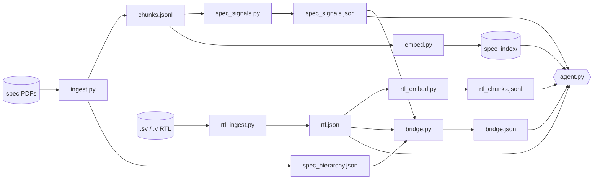

# ChipVer Architecture

Dual-RAG system that answers questions about a hardware specification, about RTL, and about
whether the RTL matches the spec, while keeping identity alignment strictly separate from
behavioural judgement.

The two corpora are ingested and retrieved **independently**, so specification prose never
competes with compiler facts in one ranking. A third artifact, the **bridge**, links them by
identity only.

This file is the current overview. Each stage's contract, measured baseline, and removed
features live in its spec under [`docs/specs/`](specs/); deferred options live in
[`docs/DEFERRED.md`](DEFERRED.md); the measured history is in MLflow (`src/track.py`).

---

## 0. Artifact map

Every stage is an isolated process that writes its artifact atomically.
`src/build.py:stage_scripts` fixes the order; `--no-embeddings` skips only stage 3.

| # | Stage | Script | Produces | Consumed by |
|---|---|---|---|---|
| 1 | spec ingestion | `ingest.py` | `chunks.jsonl`, `spec_hierarchy.json` | 2, 3, 6, agent |
| 2 | spec signals | `spec_signals.py` | `spec_signals.json` | 6, agent |
| 3 | spec index | `embed.py` | `spec_index/` (Chroma), `embed_manifest.json` | agent |
| 4 | RTL ingestion | `rtl_ingest.py` | `rtl.json` | 5, 6, agent |
| 5 | RTL records | `rtl_embed.py` | `rtl_chunks.jsonl` (not embedded) | agent |
| 6 | bridge | `bridge.py` | `bridge.json` | agent |

---

## 1. Specification ingestion ([spec](specs/ingest.md))

Text-layer PDFs only. The hierarchy comes from the PDF outline (typography fallback when a PDF
has none); recurring header and footer bands are stripped by position. Prose is split into
sentence windows capped in encoder tokens (`MAX_CHUNK_TOKENS`, overlap `OVERLAP_SENTENCES`).
Captioned tables (`Table <id>` in common caption styles, continuation banners merged) become
markdown chunks split into row windows (`MAX_TABLE_CHUNK_TOKENS`) that repeat the header row.
Every chunk carries a section breadcrumb (`context_header`); a chunk whose header plus text
exceeds `ENCODER_MAX_TOKENS` fails the run instead of being truncated.

## 2. Specification signals ([spec](specs/spec_signals.md))

Table chunks only, never prose. A table is admitted by its column headers (signal/port column,
or a name column plus width, source, or address). One record per row mention.

## 3. Specification index ([spec](specs/embed.md))

`Embedder` (default `BAAI/bge-small-en-v1.5`; model, prompts, and window are overridable from
the environment) encodes `context_header + text`; `VectorStore` persists one Chroma collection
with a content-hash manifest so the agent refuses a stale index.

## 4. RTL ingestion ([spec](specs/rtl_ingest.md))

Verilator (`--lint-only`, then `--xml-only`) is the only parser. `design_sources` finds the
package files and the top module (the one no other source instantiates; `RTL_TOP_MODULE`
overrides). `rtl.json` holds one record per source module: declarations with reader and
writer sites, structural blocks, instances with port bindings, the instance tree, package
enums, and lint warnings.

## 5. RTL records ([spec](specs/rtl_embed.md))

One record per module (ports, wiring, normalized terms, comments) and one per useful structural
block, split into `:wN` line windows past `RTL_CHUNK_CHARS`. Records are ranked lexically and
by the reranker; they are not embedded (dense vectors lowered RTL recall).

## 6. Bridge ([spec](specs/bridge.md))

Identity only, never a behavioural verdict. Spec signal rows link to RTL ports, signals, and
enum members by `identity` (STRONG) or learned `interface_prefix` (MEDIUM). Widths are stated, never used as a filter. Unresolved rows keep up to three
`SUGGESTED` candidates that never count as links. Sections link to modules by title identity
or by link support. Input fingerprints let the agent refuse a stale bridge.

---

## 7. Query time ([agent spec](specs/agent.md), [retrieve spec](specs/retrieve.md))

Linear LangGraph, every question runs both lanes:
`classify → retrieve_spec → retrieve_rtl → lookup_bridge → merge → answer`.

- **classify** records a route prior (`SPEC`, `RTL`, `COMPARISON`) from wording, plus
  identifiers that only the design declares (read from `rtl.json`, minus spec signal names).
  The answer step uses the route to decide which domains must be citable.
- **retrieve_spec**: BM25 ∪ dense candidates (`RETRIEVE_CANDIDATES` each), reranked by the
  shared cross-encoder (`RERANK_MODEL`, fp16 on CUDA) shifted by document authority; top
  `AGENT_SPEC_SEARCH_K`.
- **retrieve_rtl**: exact lookup on compiler-stated names and the constructs that read or
  write a matched signal, then BM25 candidates reranked by the same cross-encoder; windows
  fold into their record; top `AGENT_RTL_SEARCH_K`.
- **lookup_bridge**: alignments for the spec signals that a local GLiNER2 tagger
  (`SIGNAL_TAGGER_MODEL`) finds named in the question or spec passages, and for the evidence
  sections.
- **merge**: whole passages (spec, bridge rows, RTL) within `AGENT_NUM_CTX`; no truncation.
- **answer**: the local model (`LOCAL_LLM_MODEL`) returns source-quoted claims checked by
  `answer_contract.validate_answer`; when a required domain has no citable evidence the agent
  answers `AGENT_INSUFFICIENT`.

## 8. Evaluation

- `python src/bench.py --retrieval` scores retrieval on `eval/question_set.json` (60
  questions, 20 per route). Decision metrics: `retrieval.spec.section_recall_at_k` (gold by
  section, survives re-chunking) and `retrieval.rtl.exact_id_recall_at_k`; see
  [`SIMPLIFICATION_METHOD.md`](SIMPLIFICATION_METHOD.md).
- `python src/bench.py` scores full answers against `eval/gold_questions.json`.
- `python src/track.py --tag <step>` logs configuration, stage metrics, and artifacts to
  MLflow; one clean commit per run.

## 9. Design invariants

1. **Two corpora, two rankings.** Specification prose and compiler facts never compete.
2. **Identity ≠ behaviour.** The bridge aligns names; only cited source supports a verdict.
3. **Field-generic, not corpus-specific.** Code may encode hardware, Verilog, and
   SystemVerilog conventions, never facts of one PDF set or one design; vocabulary is data
   (`rtl.json`, `spec_signals.json`) or swappable config.
4. **Fail loudly instead of truncating.** Over-window chunks, Verilator errors, and stale
   artifacts stop the run.
5. **Deterministic before probabilistic.** Routing, exact lookup, and bridge links run before
   any model; the local LLM sees only the final context.
6. **Atomic artifacts and fingerprints.** Stages write through temporary files; consumers
   verify manifests and fingerprints.

---

## Related documents

| Document | Answers |
|---|---|
| `PIPELINE.md` | How do I rebuild, and what shape is each artifact? |
| `docs/specs/*.md` | What each stage must do, its measured baseline, what was removed |
| `docs/ARCHITECTURE_DECISIONS.md` | Why was each choice made? |
| `docs/SOCRATIC_ARCHITECTURE.md` | Conceptual Q&A walkthrough |
| `docs/SIMPLIFICATION_METHOD.md` | How changes are decided and measured |
| `docs/CODE_STYLE.md` | Comment and docstring conventions |
