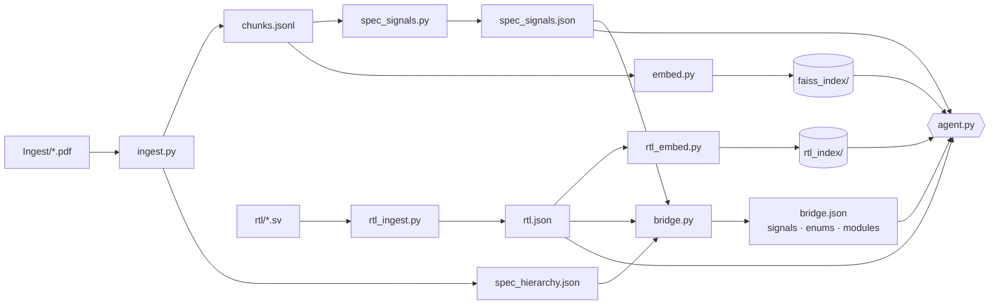
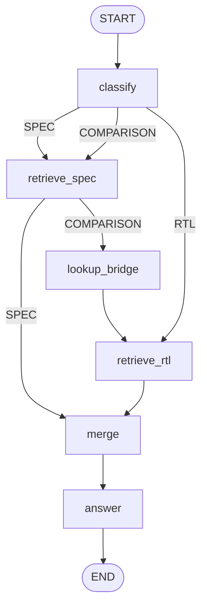
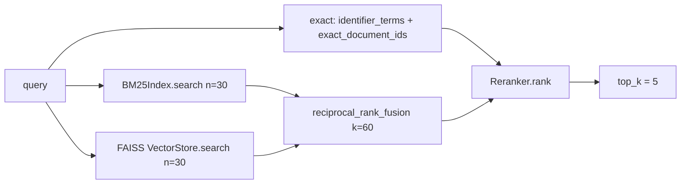

# ChipVer Architecture

Dual-RAG system that answers questions about a hardware specification, about RTL, and about
whether the RTL matches the spec — while keeping identity alignment strictly separate from
behavioural judgement.

Two corpora are ingested, indexed, and retrieved **independently** so specification prose can
never outrank compiler facts. A third artifact, the **bridge**, links them by identity only.

---

## 0. Artifact map

Every stage is an isolated process writing one artifact atomically. `src/build.py:stage_scripts`
fixes the order; `src/build.py:stage_command` adds `--rerank` to the bridge stage only.

| # | Stage | Script | Produces | Consumed by |
|---|---|---|---|---|
| 1 | spec ingestion | `ingest.py` | `chunks.jsonl`, `spec_hierarchy.json` | 2, 3, agent |
| 2 | spec signals | `spec_signals.py` | `spec_signals.json` | 6, agent |
| 3 | spec index | `embed.py` | `faiss_index/`, `embed_manifest.json` | agent |
| 4 | RTL ingestion | `rtl_ingest.py` | `rtl.json` | 5, 6, agent |
| 5 | RTL index | `rtl_embed.py` | `rtl_chunks.jsonl`, `rtl_index/`, `rtl_embed_manifest.json` | agent |
| 6 | cross-domain bridge | `bridge.py` | `bridge.json` | agent |
| — | evaluation | `bench.py` | `bench.json` | humans |

All paths are defined once in `configure.py`; nothing resolves a path relative to the launch
directory (`configure.py:ROOT`).



---

## 1. Specification ingestion — PDF to chunks

**File:** `src/ingest.py` · **Entry:** `main()` · **Per document:** `ingest_pdf(path)`
**Library:** PyMuPDF (`fitz`)

State transitions, in call order inside `ingest_pdf`:

| From → To | Function | What it does |
|---|---|---|
| PDF → document identity | `slugify`, `find_revision` | Stable `document_id`; revision string scanned from the first `REVISION_SCAN_PAGES` (4) pages |
| PDF → furniture set | `repeated_lines` | Samples `FURNITURE_SAMPLE_PAGES` (40) pages, treats lines recurring above `FURNITURE_THRESHOLD` (0.6) as headers/footers to strip |
| PDF outline → section tree | `build_sections` → `parse_section_number`, `_subtree_end_page` | Section nodes with `section_id`, breadcrumb `path`, page span |
| PDF page → tables | `build_tables` → `build_caption_index`, `is_caption`, `table_region`, `rows_by_alignment`, `unstack_row`, `extract_table`, `rows_to_markdown` | Geometric table extraction in PDF points (`COLUMN_GAP` 25, `COLUMN_SLACK` 6, `TABLE_EDGE_SLACK` 6). Emits `columns` + `rows` — **structured, not flattened text** |
| section → clean text | `section_page_texts` → `_clean_pdf_text` | Page text minus furniture, bounded by the next section title |
| text → sentences → chunks | `split_sentences` → `sliding_window_chunks` | `MAX_CHUNK_CHARS` 800, `OVERLAP_SENTENCES` 2, `ABBREVIATIONS` prevents false sentence breaks |
| chunk → enriched record | `enrich_spec_record`, `find_table_refs` | Attaches breadcrumb header, `table_ids`, `tables_cited` |
| sections → hierarchy | `hierarchy_document` | The navigable tree, written separately from content |

Sections whose title is in `SKIP_TITLES` (contents, index, bibliography) and sections under
`MIN_SECTION_CHARS` (80) are dropped.

**Output:** two chunk types in `chunks.jsonl` — `chunk_type: "prose"` (windowed text) and
`chunk_type: "table"` (carries `columns`, `rows`, `caption`, `table_label`). Both carry `chunk_id`,
`section_id`, `subsection_id`, `page`, `source_file`, `content_hash`.

Current corpus: **5,081 prose + 325 table chunks**, 427 sections across 4 documents.

---

## 2. Specification signals — tables to typed signal rows

**File:** `src/spec_signals.py` · **Entry:** `main()` → `build_spec_signals(records)`

`signals_from_table(record)` handles table chunks, deciding both **admission** and
**classification** from the column headers; prose chunks are scanned separately for widths and
instruction mnemonics.

| Header set | Constant | Field produced |
|---|---|---|
| signal, signal name, port, port name | `EXPLICIT_NAME_HEADERS` | name (and marks the table as a port table) |
| mnemonic, instruction, opcode, operation | `INSTRUCTION_HEADERS` | name (and marks the table as an instruction table) |
| name | `GENERIC_NAME_HEADERS` | name |
| number, address, csr, csr address | `ADDRESS_HEADERS` | admits a register allocation table |
| width, bits, bit width, size | `WIDTH_HEADERS` | `width` via `parse_width` |
| direction, dir, signal direction, port direction | `DIRECTION_HEADERS` | `direction` via `parse_direction` |
| source, driven by, driver, generated by, sourced by | `SOURCE_HEADERS` | `source_role` via `parse_source_role` |
| description, meaning, purpose, function | `DESCRIPTION_HEADERS` | `description` |

**Admission:** a table is read only if it has an explicit name header, an instruction header, a
width, direction, or source column, an address column (`ADDRESS_HEADERS`), or a caption matching
`_SIGNAL_CAPTION` (`signals?|ports?|interfaces?`).

The address column exists because a CSR allocation table (`Number | Privilege | Name | Description`)
carries only a generic `name` header and a caption about *addresses*, so every other admission test
missed it — which kept the whole machine-level CSR listing out of the structured layer. Column shape
was chosen over a caption pattern on measurement: it admits exactly the 7 register-listing tables in
the corpus, where a `csrs?|registers?` caption regex also pulled in 9 tables with no name column.

**Classification (`row_kind`)**, in precedence order:

| Kind | When | Aligned against |
|---|---|---|
| `port` | explicit name header, direction column, source column, or signal-ish caption | RTL ports |
| `instruction` | a mnemonic / instruction / opcode / operation column | RTL enumeration members |
| `register_field` | anything else admitted (a CSR bit-field or register allocation table) | RTL internal signals |

This is what stops a register bit-field row from being matched against an RTL port, and what routes
instruction mnemonics away from signal matching entirely.

**Instruction mnemonics from prose.** `instructions_from_prose(record)` reads dotted mnemonics
directly from prose, because instruction listings frequently do **not** survive PDF extraction as
tables — the RISC-V F-extension listing arrives as flattened running text ending in "Table 20."
`_MNEMONIC` (`\b([A-Z]{2,}(?:\.[A-Z0-9]+)+)\b`) requires a letters-only first segment, which keeps
section numbers such as `A15.3` and `B2.2` out. The trade-off is deliberate: undotted mnemonics
(`BEQ`, `CSRRW`, `SUB`) are unreachable from prose and must come from the table path, because
matching undotted uppercase words would catch every acronym in the specification.

**Role vs direction.** `_SOURCE_ROLE` normalises the interface-role vocabulary
(`manager/master/initiator/requester/transmitter/tx` → `manager`;
`subordinate/slave/target/completer/receiver/rx` → `subordinate`). A role is *who drives the
signal*, not a direction — direction is derived later, in the bridge, once the module's own role is
known. `_parsed_cell` reads role and direction from whichever column actually states them, so a
`Direction` column holding `Manager` and a `Source` column holding `input` both work.

**Prose width backfill.** `prose_widths(records)` scans non-table chunks for `NAME[hi:lo]`
(`_PROSE_WIDTH`), keeping a name only when every mention agrees. `build_spec_signals` fills `width`
where the table stated none, tagging `width_source: "prose bit range"`.

Current corpus: **1055 rows** — 487 `port`, 405 `instruction`, 163 `register_field`; 140 carry a
`source_role`; 20 widths recovered from prose; 283 of the instructions come from prose rather than
tables. Extracting instructions is what first gave `riscv_privileged` any presence at all — it
previously contributed **zero** rows.

---

## 3. Specification index — chunks to vectors

**File:** `src/embed.py` · **Entry:** `main()`

| Component | Implementation | Config |
|---|---|---|
| Embedder | `Embedder(Embeddings)` wrapping `sentence_transformers.SentenceTransformer` | `EMBED_MODEL = "BAAI/bge-small-en-v1.5"`, `EMBED_DEVICE = "cuda"` (falls back via `available_device`), `EMBED_BATCH = 64`, `EMBED_NORMALIZE = True` |
| Passage encoding | `Embedder.embed_documents` | encoded **bare** |
| Query encoding | `Embedder.embed_query` | prefixed with `EMBED_QUERY_PREFIX` = `"Represent this sentence for searching relevant passages: "` — BGE is asymmetric, the prefix belongs on queries only |
| Vector store | `VectorStore` wrapping `langchain_community` **FAISS** | persisted to `faiss_index/` |
| Document projection | `record_to_document(record)` | chunk record → LangChain `Document` with metadata |

**Resumability.** `content_hash`, `chunk_fingerprint`, `record_fingerprint`, `build_manifest`,
`read_manifest`, `write_manifest` keep `embed_manifest.json` beside the index. Re-embedding is
skipped when fingerprints match.

---

## 4. RTL ingestion — SystemVerilog to a module graph

**File:** `src/rtl_ingest.py` · **Entry:** `main()` → `run_verilator` → `build(xml_path, lint_text)`
**Tool:** Verilator, invoked twice — `--lint-only` for warnings, `--xml-only` for the AST.
`VERILATOR_ARGS` pins `--top-module riscv_top` and the include path.

Nothing is written if Verilator reports `%Error` — `run_verilator` raises `SystemExit` first, so a
broken build can never leave a half-true artifact behind.

| From → To | Function | What it does |
|---|---|---|
| XML → file table | `file_table`, `parse_loc` | Verilator location codes → real paths and line ranges |
| XML → type table | `type_descriptors`, `_range_descriptor`, `_integer` | Resolves `dtype_id` to concrete widths; **every port width lands as an elaborated integer** |
| XML → declarations | `symbol_records` → `_declaration_record`, `_symbol_kind`, `_assign_symbol_ids` | Ports and internal signals with stable `signal_id`; `_normal_direction` maps Verilator's `in`/`out` to `input`/`output`, everything else becomes `internal` |
| XML → use sites | `driver_reader_sites` → `_assignment_signal_roles`, `_construct_signal_roles`, `statement_site`, `collapse_sites` | Per-signal `reader_sites` / `writer_sites` with file and line |
| XML → structural blocks | `modules` → `_block_record`, `_assignment_groups`, `_sensitivity`, `_block_type` | `always_blocks`, `functions_tasks`, `assignment_groups`, `other_blocks`, each with `signals_read` / `signals_written` and exact line spans |
| XML → instance tree | `tree`, `_cell_paths`, `_instance_record` | Elaborated hierarchy |
| XML → enumerations | `enum_types` → `_enum_item` | Every `<enumdtype>` with its members, decoded values, and file/line |
| enums + blocks → usage | `enum_usage` → `_declared_names`, `_usage_blocks` | Which blocks name each member |
| lint text → warnings | `parse_warnings` | Preserved in the artifact |

**Output** `rtl.json`: `{schema_version, top_module, tree, modules, enums, warnings}`. Current
design: **35 modules, 1,506 declarations** (389 `input`, 325 `output`, 792 `internal`), and
**24 enumerations / 230 members / 326 usage sites**.

### Enumerations

Verilator emits packages and enumerations in the type table but **erases the enum type during
elaboration** — no `varref` carries the enum's dtype id, and a `case (FADD_S)` arm appears as
`<const name="5'h0">`. So the declaration table and the elaborated logic are disconnected, and the
join has to go through identifiers rather than dtype ids. That is safe precisely because
enumeration member names are unique tokens.

`enum_usage` therefore scans each block's `source_code` for the member name, with one guard: **a
module that itself declares that identifier is not credited**. Across this design only two members
collide with a declared identifier (`load_store_t.B`, `mul_sel_t.sign`), and the guard is what makes
short member names measurable at all — `load_store_t` reads a true 4/5 rather than being lost to a
length heuristic.

The result is a coverage fact with source provenance on both sides, computable without any model:

```
fpu_operation_t  21/21     alu_operation_t 18/18     opcode_t 9/9     csr_index_t 17/17
axi_resp_t        2/8      axi_burst_t      2/4      flp_t    1/2     load_store_t  4/5
fpu_mode_t        0/4      <- declared at shared_pkg.sv:195-199, referenced nowhere
```

---

## 5. RTL index — module surfaces to vectors

**File:** `src/rtl_embed.py` · **Entry:** `main()` → `retrieval_records(rtl)`

Two record families, module-first:

1. `chunks(rtl, children)` — one record per module: name, ports, instantiated children, and
   `comments(source_code)` prose capped at `RTL_CHUNK_COMMENT_CHARS` (1200) so a large module cannot
   dominate the index.
2. `_structural_records(rtl)` — one record per useful `always_block` / `function_task` /
   `assignment_group`, carrying `signals_read`, `signals_written`, `file`, `start_line`, `end_line`.

Same `Embedder` and FAISS machinery as the spec side, but a **separate index directory**
(`RTL_INDEX_DIR`) and manifest. `index_manifest_status(records, index_dir, manifest_path)` is the
freshness gate — it reports `"manifest mismatch"` rather than serving stale vectors.

---

## 6. The bridge — how spec and RTL are linked

**File:** `src/bridge.py` · **Entry:** `main()` → `build_bridge(spec_data, rtl_data, hierarchy_data, …)`

This is the only place the two domains meet, and it aligns **identities only**. The module docstring
states the contract: *the bridge never decides whether RTL implements a requirement.*

### 6.0 Canonicalisation

`spec_signals(data)` → `_canonical_spec_signal` and `rtl_signals(rtl)` → `_canonical_rtl_signal`
normalise both sides into one shape, tolerating field aliases from older artifacts. `_width` returns
a concrete integer or `None` — symbolic widths like `DATA_WIDTH` or `clog2(N)` become `None` rather
than being compared as strings. `naming.py` supplies `normalize_identifier`, `identifier_tokens`
(abbreviation expansion), and `normalize_module_name`.

### 6.1 Module role inference

`with_module_roles(rtl_rows, specs)` → `module_roles(specs, rtl_rows)`

A module drives what its own role sources. So an identically named port — allowing one known
namespace prefix via `_namespace_prefixed`, e.g. spec `AWVALID` ↔ RTL `MAWValid` — votes for the
spec's role when it is an `output`, and for the opposite role when it is an `input`. A module keeps a
role only with `_ROLE_VOTE_MIN` (2) votes and a strict majority, so one generic name cannot decide it.

Current design: `cache`, `fetch_stage`, `memory_stage`, `riscv_processor` → **manager**;
`risc_data_memory`, `risc_instruction_memory` → **subordinate**.

### 6.2 Layer 1 — cheap name candidates

`generate_signal_candidates(spec, rtl_rows)` → `cheap_name_evidence(spec, rtl)`

Probes, each recorded independently in `cheap_evidence`: `exact_name` (1.00),
`normalized_name` (0.97), `namespace_prefix` (0.94), `direction_suffix` (0.92),
`abbreviation_expansion` (0.90), `token_overlap` (Jaccard), `edit_similarity`
(`SequenceMatcher` × `BRIDGE_EDIT_WEIGHT` 0.8). Score is the max.

Eligibility requires a probe to fire **and** the declaration classes to match — a `port` spec row
against a real port, a `register_field` row against an `internal` signal. Outright name identity
bypasses that filter. `BRIDGE_MIN_CANDIDATES` / `BRIDGE_MAX_CANDIDATES` (3/3) guarantee exactly three
inspectable candidates.

### 6.3 Layer 2 — structural scoring

`rerank_signal_candidates` → `structural_signal_score(spec, candidate)`

| Component | Weight | Source |
|---|---|---|
| `name` | 0.40 | layer-1 score |
| `width` | 0.15 | integer equality |
| `section_module` | 0.15 | Jaccard(section title, module tokens) |
| `direction` | 0.12 | `expected_direction(spec, rtl)` vs RTL direction |
| `description_usage` | 0.12 | Jaccard(spec description, `_signal_usage`) |
| `table_context` | 0.06 | Jaccard(table caption, module context) |

`expected_direction` uses an explicit spec direction when present; otherwise it derives one —
**same role as the module ⇒ `output`, opposite role ⇒ `input`**. When the RTL side is `internal`,
`_suffix_direction` infers from a trailing `_i` / `_o` token.

`_weighted_components` averages **only components marked `available`**, renormalising by their
weight sum — missing evidence is a removed vote, not a penalty. Each component is stored as
`{score, weight, available, detail}` with `detail` holding the literal comparands
(`"spec='input' via role subordinate/manager, rtl='input'"`).

**Width gate.** `_width_conflict(spec, candidate)` rejects a candidate whose concrete width
contradicts a concrete spec width — unless the names are outright identical, in which case the
disagreement is kept visible as evidence instead of discarding the pair. Rejected candidates are
persisted with `rejected_by: "width"` and never counted as survivors.

Survivors need `structural_score ≥ BRIDGE_STRUCTURAL_MIN` (0.38).

### 6.4 Layer 3 — semantic rerank

Only survivors are embedded. `_spec_pair_text` / `_rtl_pair_text` render compact pair context
(≤ `BRIDGE_CONTEXT_CHARS` 1200); `retrieve.Reranker.score_pairs` (cross-encoder
`ms-marco-MiniLM-L-6-v2`) scores them; `_semantic_unit` squashes logits into the unit interval.

`final = 0.8 × structural + 0.2 × semantic` (`BRIDGE_SEMANTIC_WEIGHT`).

### 6.5 Decision

`align_signal(spec, rtl_rows, scorer, llm_resolver)`, in order:

1. no survivor → `unresolved`, reason `"no candidate survived structural scoring"`, or
   `"every candidate contradicts the specified width"` when the gate ate them all
2. top two within `BRIDGE_AMBIGUITY_MARGIN` (0.05) → ambiguous, **unless** exactly one of the close
   candidates has the most compiler-observed usage (`_implementation_sites` = reader + writer sites),
   which selects it — a driving module beats identically named pass-through ports
3. ambiguous **and** a resolver is configured → `ollama_resolver` (schema-constrained,
   `BRIDGE_LLM_MAX_CANDIDATES` 3, `BRIDGE_LLM_MAX_TOKENS` 256); `bounded_resolver` caps the whole
   build at `BRIDGE_LLM_MAX_CALLS` = **300**. Resolution can only *lower* confidence (`min`).
   `ollama_resolver` returns the model's **raw text**, not parsed JSON, so `_resolver_result` owns
   the single `json.loads` and a truncated reply degrades that signal to `unresolved` instead of
   raising through the build. `BRIDGE_LLM_MAX_TOKENS` was 96, below the 95–144 tokens a complete
   reply needs, so 6 of 8 replies truncated mid-`reason` and aborted the run
4. `score < BRIDGE_ACCEPT_MIN` (0.62) → `unresolved`
5. still ambiguous with no resolution → `unresolved`
6. accept → band via `confidence_level`: WEAK ≥ 0.62, MEDIUM ≥ 0.74, STRONG ≥ 0.88

### 6.6 Enumeration alignment — instructions to RTL enum members

`enum_members(rtl_data)` flattens every declared member into a comparable row; `align_enum(spec,
members)` maps one specification `instruction` row onto it.

This layer is deliberately **not** the layered candidate machinery above, because it does not need
to be. `normalize_identifier` already converges spec `FADD.S` and RTL `FADD_S` onto `fadd_s`, so
matching is exact identity — there is no rival candidate to rank, and therefore nothing inspectable
to persist for a miss beyond a count.

Two components, both always available:

| Component | Weight | Meaning |
|---|---|---|
| `name` | 0.7 | normalized instruction identity |
| `implementation` | 0.3 | does the member have any usage site |

A member that is declared but never referenced scores 0.7 → `WEAK`; an implemented one scores 1.0 →
`STRONG`. `build_bridge` routes `instruction` rows here and **excludes them from signal alignment**,
so they no longer generate dead candidate sets against RTL ports.

Current design: **30 enum alignments — 29 STRONG, 1 WEAK**, the only STRONG alignments anywhere in
the artifact. `fpu_operation_t` 20, `round_mode_t` 6, `alu_operation_t` 3, `axi_burst_t` 1, against
405 instruction rows.

The single WEAK is the payoff case: spec `RESERVED` (axi_spec p.193) → `axi_burst_t.RESERVED = 3`,
declared at `shared_pkg.sv:325` with **zero usage sites** — a specified value that exists as a type
and is never implemented.

### 6.7 Section-to-module alignment

`derive_module_alignments(hierarchy, modules, alignments, specs)` runs **after** signals, because one
of its components depends on them: `name` 0.5, `child_signals` 0.3, `context` 0.2
(`BRIDGE_MODULE_WEIGHTS`). `_module_candidate` gates eligibility on `BRIDGE_MODULE_NAME_MIN` (0.45),
`BRIDGE_MODULE_CONTEXT_MIN` (0.15), or having a child alignment; `BRIDGE_MODULE_PERSIST_NAME_MIN`
(0.55) decides whether a section with no signals is persisted at all.

### 6.8 Output and freshness

`bridge.json` = `{schema_version, source_fingerprints, signal_alignments, unresolved_signals,
enum_alignments, module_alignments, summary}`. `source_fingerprints` are SHA-256 hashes of the three
inputs (`source_fingerprints()`), written by `_write_bridge` atomically.

Current state (built with `--rerank --llm`): **16 signal alignments / 634 unresolved** of 650 port
and field rows, all 16 in the `WEAK` band; **30 enum alignments** of 405 instruction rows (29
`STRONG`, 1 `WEAK`); and 2 accepted of 47 persisted section alignments. 52 resolver calls.

The flags matter: the same build without `--rerank` resolves **3** signal alignments, because
`final = 0.8 × structural + 0.2 × semantic` both breaks exact ties and lifts borderline pairs over
`BRIDGE_ACCEPT_MIN`. Unresolved reasons are dominated by candidate generation, not by the decision
gates — 398 `"no candidate survived structural scoring"` and 124 `"every candidate contradicts the
specified width"`, against 110 below-threshold and 2 still ambiguous. Neither the cross-encoder nor
the resolver can reach the first two buckets: both rerank a shortlist that `BRIDGE_MAX_CANDIDATES`
has already capped at 3.

---

## 7. Query time — the agent

**File:** `src/agent.py` · **Framework:** LangGraph `StateGraph` · **State:** `State(TypedDict)`
**Entry:** `build_graph(...)` → `run(app, question)` / `ask(app, question)`

### 7.1 Graph



**The graph is a DAG — there is no reason/act loop and no re-query cycle.** One question is one
forward pass. Each node appends to `state["trace"]` via `_append_trace`, so the whole run is
inspectable after the fact (`trace_report`).

The only LLM-driven iteration anywhere in the system is the bridge's ambiguity resolver at
**build** time, hard-capped at one call per build.

### 7.2 Nodes

| Node | Function | Reads | Writes to state |
|---|---|---|---|
| `classify` | `classify_node` → `classify_query` | question | `query_type` ∈ {SPEC, RTL, COMPARISON} — regex only, no model |
| `retrieve_spec` | `spec_node` → `Runtime.spec_search`, `_hit_record`, `expand_spec_hierarchy`, `select_spec_signals` | FAISS spec index, `spec_hierarchy.json`, `spec_signals.json` | `spec_evidence`, `spec_signals` |
| `lookup_bridge` | `bridge_node` → `lookup_bridge` | `bridge.json` | `bridge_matches`, `module_matches` |
| `retrieve_rtl` | `rtl_node` → `bridge_targets`, `Runtime.rtl_search`, `surrounding_rtl_blocks`, `_dedupe_evidence` | RTL FAISS index, `rtl.json` | `rtl_evidence`, `rtl_blocks` |
| `merge` | `merge_node` → `merge_evidence` | all of the above | `final_context` |
| `answer` | `answer_node` → `Runtime.answer_model` → `local_answer` | `final_context` | `answer` |

**Routing** is deterministic: `_COMPARISON` regex wins, then `_RTL` / `_RTL_IDENTIFIER`, else SPEC.

**Over-fetch and near-duplicate suppression.** `spec_node` asks for `AGENT_SEARCH_K ×
AGENT_SPEC_OVERFETCH` (3 × 3) hits, drops near-duplicates via `drop_near_duplicates`, then truncates
back to `AGENT_SEARCH_K`. Sentence-overlap chunking (`OVERLAP_SENTENCES` 2 against a *character* cap)
makes consecutive chunks share whole sentences — three retrieved chunks were once three copies of one
passage, spending the whole spec lane on one sentence. Duplication is literal, so it is detected
literally: shared word `AGENT_DEDUP_SHINGLE`-grams (8) over the shorter chunk, rejected at
`AGENT_DEDUP_MAX_OVERLAP` (0.25). Measured separation is wide — sliding-window siblings score
0.32–0.76, genuinely distinct chunks 0.00–0.12. Over-fetching is what makes this reallocate slots
rather than shrink the evidence.

**Hierarchy expansion.** `expand_spec_hierarchy(hits, hierarchy, records, limit=2)` pulls a bounded
number of sibling and parent chunks so a retrieved paragraph carries its structural neighbours.

**Signal selection.** `select_spec_signals(question, evidence, signals, limit=8)` picks the
structured spec-signal rows relevant to the question via `_name_tokens`.

### 7.3 Bridge lookup and retrieval steering

`lookup_bridge(signals, spec_evidence, artifact, limit=12)` matches on spec `signal_id` **or**
casefolded spec name, concatenating `signal_alignments` then `unresolved_signals`, capped at 12.
Section alignments are matched on `section_id` / `subsection_id` from retrieved chunk metadata.

**Why the labels are `identity_match` / `identity_score`.** These rows previously rendered as
`confidence=WEAK score=0.695039`, and both labels were unqualified: nothing said the number measured
*identity* — how sure we are the two identifiers denote the same object, per §6.4 — rather than how
sure we are the RTL behaves per the spec. Asked "does the RTL implement this rule?", a reader had no
textual cue against reading `confidence=WEAK` as a weak verdict, and `WEAK`/`MEDIUM`/`STRONG`
reinforce that by sounding like verdict strength. The only correction was one sentence in the
answering system prompt ("An alignment says where to inspect, never that behavior is correct"),
sitting far from the data — and observed runs showed it losing: an answer asserted full compliance
while citing `confidence=WEAK score=0.695039`, unchanged at ten times the context window. The
bridge's own `ollama_resolver` made the same slip, echoing the structural score `0.692105` back as
*its* confidence in its own choice — two different models, one representation, so the defect was in
the rendering rather than the reader. The labels now name what they measure, keeping the qualifier
attached to the number; §6 states the contract, and the emitted text carries it. The band names are
unchanged, so `WEAK`/`MEDIUM`/`STRONG` still read as strength — of identity evidence now, not of a
verdict.

`bridge_targets(signal_matches, module_matches)` then harvests RTL names from both the mapping and
its **candidates** — so unresolved rows still steer retrieval. Those names steer the block lane
only: the vector search runs on the question alone, because appending targets to the query made
them exact lookup terms that crowded the question's own module out of every slot.
`surrounding_rtl_blocks(rtl, signal_names, module_names, limit=AGENT_RTL_BLOCKS)` pulls the exact AST
blocks that read or write those signals straight out of `rtl.json`, with file and line. Each
selected block records the `matched_signals` that earned it a place.

**Staging hop.** A registered value lives under two identifiers in SystemVerilog — the block that
*decides* it writes `X_next`, while only the flip-flop writes `X`. Selecting by the target name
alone therefore returns the register and never the logic. `_staged_names(wanted, module)` expands
each target with the module's own partners using `_STAGING_SUFFIX`:

```
_next _nxt _new _comb _pre _post _reg _ff _sync _d _q _r   (+ pipeline depth: _d1, _q2, _ff1)
```

`_n` is deliberately excluded — it conventionally marks active-low, not next-state, so including it
would wrongly bind `rst` to `rst_n`. The safety net is that a hop only fires when **both**
identifiers are declared in the same module, so a wrong suffix guess cannot invent a target. Direct
hits still outscore staged ones (`2·direct + staged + module`).

**This is the link at query time:**

```
spec chunk → spec signal → bridge alignment → RTL signal name → RTL module / AST block → file:line
```

### 7.4 Evidence rendering and budgets

`merge_evidence(state)` allocates a hard character budget:

| Lane | Renderer | Cap |
|---|---|---|
| spec | `_spec_context` | `AGENT_SPEC_CONTEXT_CHARS` 4500 (40 % share) |
| RTL | `_rtl_context` → `_excerpt_block` | `AGENT_RTL_CONTEXT_CHARS` 5500 (45 %) |
| bridge | `_bridge_context` → `_alignment_site`, `_evidence_detail` | `AGENT_BRIDGE_CONTEXT_CHARS` 2500 |
| total | `_bounded` | `AGENT_CONTEXT_CHARS` 12500, marks `[TRUNCATED]` |

Two rules keep the RTL lane useful rather than merely full:

**Targeted blocks render before retrieved evidence.** Blocks are selected by exact signal identity
through the bridge; vector hits are approximate. Rendering the approximate evidence first let
5,122 characters of it consume a 5,467-character lane and truncate away every targeted block.

**Oversized blocks are excerpted, not truncated.** A 331-line FSM cannot share the lane whole, so
`_excerpt_block` keeps only the neighbourhood of each `matched_signals` hit, marking every elision
with `[...]`. Thresholds are `AGENT_RTL_BLOCK_CHARS` (1200) and `AGENT_RTL_BLOCK_CONTEXT_LINES` (1).
On the AXI handshake question this reduces `cache.sv:660-991` from 16,295 to 1,870 characters while
retaining both lines that settle it — the assertion at `cache.sv:698` and the sole `READY`
dependency at `cache.sv:843`. Before these two rules the model received the flip-flop and nothing
else.

Bridge rows render as name → name, identity band, identity score, the citable `file:line`, the
falsifiable width and direction comparisons, and the rejection reason:

```
signal ARREADY -> MARReady identity_match=WEAK identity_score=0.680608 at fetch_stage.sv:74 [width spec=1, rtl=1]
signal CRCRDT  -> UNRESOLVED identity_score=0.0 [width spec=1, rtl=32; direction spec='input' via role
                  subordinate/manager, rtl='input'] reason=every candidate contradicts the
                  specified width candidates=MRRData
```

### 7.5 Answering

`local_answer(prompt)` posts to Ollama at `LOCAL_LLM_HOST` with `AGENT_MODEL` = `qwen3:4b`,
`temperature 0`, `num_ctx = AGENT_NUM_CTX` (4096), timeout `AGENT_TIMEOUT_S` (300).

System prompt: use only supplied evidence; cite spec chunk/page and RTL file/line;
**an alignment says where to inspect, never that behaviour is correct**; answer a comparison with
*implemented / partially implemented / missing / contradictory / insufficient evidence*.

`answer_node` short-circuits **before** calling the model when a route-required lane is empty,
emitting `AGENT_INSUFFICIENT` (`"INSUFFICIENT"`) — SPEC and COMPARISON need spec evidence, RTL and
COMPARISON need RTL evidence.

### 7.6 Freshness gates

`Runtime` lazily loads each artifact and re-checks it. `Runtime.get_bridge` recomputes
`bridge.source_fingerprints()` and raises `ArtifactFreshnessError` —
*"cross-domain bridge is stale; run python src/bridge.py"* — rather than answering from a stale map.
The RTL index has the equivalent guard in `rtl_embed.index_manifest_status`.

---

## 8. Retrieval internals

### 8.1 Specification — `src/retrieve.py`

`Retriever.load(records, index_dir, embedder, reranker)` assembles four independently replaceable
lanes. `Retriever.search(query, top_k)`:



1. `identifier_terms(query)` → `exact_document_ids` — literal identifier hits, **always ranked first**
2. `BM25Index.search` and `VectorStore.search`, `RETRIEVE_CANDIDATES` (30) each
3. `reciprocal_rank_fusion([lexical, dense], RETRIEVE_RRF_K=60)`
4. `Reranker.rank` — cross-encoder `RERANK_MODEL` (`cross-encoder/ms-marco-MiniLM-L-6-v2`),
   `RERANK_BATCH` 32 — applied to exact hits and the fused shortlist separately, so literal matches
   keep their precedence
5. truncate to `RETRIEVE_TOP_K` (5); the agent asks for `AGENT_SEARCH_K` (3)

### 8.2 RTL — `src/rtl_embed.py`

`RTLRetriever.search(query, top_k)` puts **compiler metadata ahead of semantics**:

1. `exact_lookup(query, records)` → `_query_terms`, `_term_strength` — exact module and signal name
   hits from `rtl.json` metadata; `_phrase_strength` also accepts a module's spelled-out
   `normalized_name` ("control status register file" → `csr_file`), and only identifier-shaped
   terms may match signal names, so a plain word ("multiplier") cannot pin the wrong module first
2. when a signal matches exactly, pull the `construct` records in that module whose
   `signals_read` / `signals_written` contain it, sorted writers-first — the blocks that actually
   drive the signal
3. only if exact results are short does `_hybrid()` lazily build the BM25 + FAISS + cross-encoder
   stack against `RTL_INDEX_DIR`

---

## 9. Evaluation

**File:** `src/bench.py` · **Gold:** `eval/gold_questions.json` · **Output:** `output/bench.json`

`main()` → `load_gold` → `run(build_graph(), questions)` → `score` per case → `tally` +
`aggregate_metrics`.

`score(answer, gold)` returns `correct` / `wrong` / `unverified` / `abstained` by substring matching
`requires` groups and `forbids` terms, with `abstention_is_correct` deciding whether an
`INSUFFICIENT` answer counts as right.

`aggregate_metrics` reports `spec_recall_at_k`, `spec_mrr`, `rtl_recall_at_k`, `rtl_mrr`,
`routing_accuracy`, `alignment` (`recall_at_k`, `mrr`, `top1_accuracy`),
`comparison_both_domain_rate`, `citation_completeness`.

> **Known limitations, measured.** Scoring is literal substring matching over free prose, so it
> measures wording as much as reasoning — an answer saying "implements" fails a `requires` of
> `"implemented"`. The `alignment` metrics are saturated at 1.0, leaving no headroom to detect
> bridge changes, and no gold case asserts a direction, width, role, or rejection reason.
>
> The bench is also **not run-to-run reproducible**, which was verified rather than assumed: the
> same question run three times against untouched artifacts produced one byte-identical retrieval
> trace (17,047 bytes, floats intact) and **three different answers**, despite `temperature: 0`. The
> evidence pipeline is deterministic; the local model is not. A ±1 movement on a seven-question set
> therefore carries no information.
>
> Artifact-level assertions against `bridge.json` and `rtl.json` would measure the alignment layer
> far more directly, deterministically, and in seconds rather than minutes.

`tally` materialises its argument before counting. It previously called `list(outcomes).count(label)`
inside a dict comprehension while `main()` passed a generator, so every label after the first counted
over an exhausted iterator and reported 0 — a summary claiming `unverified: 0` beside three
`unverified` rows.

---

## 10. Configuration index

Everything tunable lives in `src/configure.py`.

| Group | Keys |
|---|---|
| Paths | `ROOT`, `INGEST_DIR`, `OUTPUT_DIR`, `CHUNKS_PATH`, `SPEC_HIERARCHY_PATH`, `SPEC_SIGNALS_PATH`, `INDEX_DIR`, `MANIFEST_PATH`, `RTL_DIR`, `RTL_PATH`, `RTL_CHUNKS_PATH`, `RTL_INDEX_DIR`, `RTL_MANIFEST_PATH`, `BRIDGE_PATH`, `GOLD_PATH`, `BENCH_PATH` |
| Chunking | `MAX_CHUNK_CHARS` 800, `OVERLAP_SENTENCES` 2, `MIN_SECTION_CHARS` 80, `SKIP_TITLES`, `ABBREVIATIONS` |
| PDF geometry | `COLUMN_GAP` 25, `COLUMN_SLACK` 6, `TABLE_EDGE_SLACK` 6, `MIN_TABLE_HEIGHT` 4, `FURNITURE_SAMPLE_PAGES` 40, `FURNITURE_THRESHOLD` 0.6 |
| Embedding | `EMBED_MODEL`, `EMBED_DEVICE`, `EMBED_BATCH`, `EMBED_NORMALIZE`, `EMBED_QUERY_PREFIX` |
| Retrieval | `RETRIEVE_CANDIDATES` 30, `RETRIEVE_TOP_K` 5, `RETRIEVE_RRF_K` 60, `RERANK_MODEL`, `RERANK_BATCH` 32 |
| RTL | `RTL_TOP_MODULE` `riscv_top`, `VERILATOR_ARGS`, `RTL_CHUNK_COMMENT_CHARS` 1200 |
| Bridge scoring | `BRIDGE_SIGNAL_WEIGHTS`, `BRIDGE_MODULE_WEIGHTS`, `BRIDGE_EDIT_WEIGHT` 0.8, `BRIDGE_EDIT_MIN` 0.55, `BRIDGE_TOKEN_MIN` 0.2 |
| Bridge gates | `BRIDGE_STRUCTURAL_MIN` 0.38, `BRIDGE_ACCEPT_MIN` 0.62, `BRIDGE_MEDIUM_MIN` 0.74, `BRIDGE_STRONG_MIN` 0.88, `BRIDGE_AMBIGUITY_MARGIN` 0.05, `BRIDGE_SEMANTIC_WEIGHT` 0.2 |
| Bridge budgets | `BRIDGE_MIN_CANDIDATES` / `BRIDGE_MAX_CANDIDATES` 3, `BRIDGE_LLM_MAX_CALLS` 300, `BRIDGE_LLM_MAX_TOKENS` 256, `BRIDGE_PROVENANCE_SITES` 2, `BRIDGE_CONTEXT_CHARS` 1200 |
| Agent | `AGENT_MODEL` `qwen3:4b`, `AGENT_NUM_CTX` 4096, `AGENT_TIMEOUT_S` 300, `AGENT_SEARCH_K` 3, `AGENT_RTL_BLOCKS` 6, `AGENT_CONTEXT_CHARS` 12500, `AGENT_SPEC_CONTEXT_CHARS` 4500, `AGENT_RTL_CONTEXT_CHARS` 5500, `AGENT_BRIDGE_CONTEXT_CHARS` 2500, `AGENT_RTL_BLOCK_CHARS` 1200, `AGENT_RTL_BLOCK_CONTEXT_LINES` 1, `AGENT_INSUFFICIENT`, `AGENT_SPEC_OVERFETCH` 3, `AGENT_DEDUP_SHINGLE` 8, `AGENT_DEDUP_MAX_OVERLAP` 0.25 |

---

## 11. Design invariants

1. **Two corpora, two indexes.** Specification prose and compiler facts never compete in one ranking.
2. **Each specification row aligns against the RTL construct of its own kind.** Ports to ports,
   register fields to internal signals, instructions to enumeration members. Interface specifications
   (AXI) declare signals; instruction-set specifications (RISC-V) declare mnemonics and encodings —
   one matcher cannot serve both, and forcing it produces dead candidate sets rather than answers.
3. **Identity ≠ behaviour.** The bridge aligns names; only cited AST blocks can support a verdict.
   Enforced in the module docstring, in the system prompt, and by a test asserting no behavioural
   verdict string is ever serialised into `bridge.json`.
4. **Everything is inspectable.** Every score decomposes into `{score, weight, available, detail}`;
   every rejection carries a reason; every alignment carries file, line, and use sites.
5. **Missing evidence is a removed vote, not a penalty** (`_weighted_components`).
6. **Deterministic before probabilistic.** Regex routing, exact-name lookup, and structural gates all
   run before any model is asked anything; the local LLM sees only the final bounded context.
7. **Bounded model usage.** One answer call per question; at most one tiny-model tiebreak per bridge
   build.
8. **Atomic artifacts and fingerprints.** Every stage writes via a temporary file and `replace`;
   downstream stages verify SHA-256 fingerprints and refuse to serve stale data.

---

## Related documents

| Document | Answers |
|---|---|
| `PIPELINE.md` | How do I rebuild, and what shape is each artifact? |
| `docs/ARCHITECTURE_DECISIONS.md` | Why was each choice made? (17 ADRs) |
| `docs/SOCRATIC_ARCHITECTURE.md` | Conceptual Q&A walkthrough |
| `docs/CODE_STYLE.md` | Comment and docstring conventions |
| **this file** | What happens, in order, in which file, through which function? |
